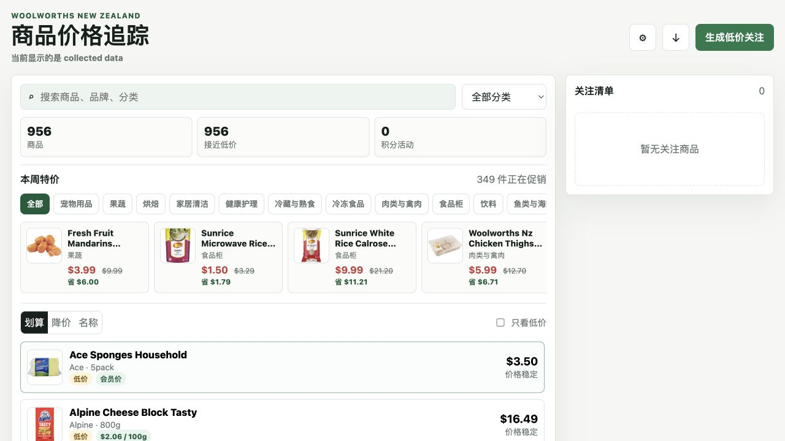

# Woolworths NZ Price Tracker

## Universal Price Memory (new in this evolution)

> This project has been generalized from a Woolworths NZ-only tracker into
> **Universal Price Memory**: a retailer-agnostic price history, sale-scoring
> and alerting layer that works for any retailer.

**What's new**

- **Retailer-agnostic schema** — every observation is keyed by
  `(retailer, product_id)` with `name`, `price`, `currency`, `timestamp`
  (plus optional `brand`, `url`). The old Woolworths `stockcode` model maps
  cleanly onto it (`retailer = "woolworths-nz"`), so existing data and
  collectors keep working.
- **Local price-history store** — `price_memory/store.py`: a small SQLite
  layer (stdlib only) with the same data-integrity stance as the original —
  zero/negative/non-finite prices are rejected before persistence, and
  product + snapshot writes happen in one transaction.
- **Sale-quality scoring** — `price_memory/scoring.py`: answers *"is this
  sale genuinely good?"* by ranking the current price against the last 90
  days of history (percentile + labels: `historic-low`, `great-deal`,
  `good-deal`, `fair`, `poor`). `is_genuine_sale()` also sanity-checks
  advertised "was $X" prices against observed history.
- **Alerts** — `price_memory/alerts.py`: persistent rules for `below_price`,
  `historic_low` and `drop_pct`, plus automatic historic-low detection.
- **Browser-capture import** — `price_memory/capture.py`: a documented
  JSON-lines format a browser extension can POST/append while you shop
  (see `CAPTURE_FORMAT_DOC`), with strict validation on import.
- **CLI** — `python3 -m price_memory.cli`: `init`, `record`, `score`,
  `add-rule`, `alerts`, `import-capture`, and a `demo` that seeds
  multi-retailer data.

Quick start:

```bash
python3 -m price_memory.cli demo          # seed demo data, see scores + alerts
python3 -m price_memory.tests.test_all    # run the sanity tests
```

The original Woolworths NZ Node.js app (collector, PWA, API) is untouched
below — the Python layer is additive.

<div align="center">

**A bilingual web app for collecting, validating, and understanding grocery price changes over time.**

[](https://github.com/yichengwang4242/woolworths-nz-price-tracker/actions/workflows/quality.yml)


</div>



## Why I built this

I work part-time at Woolworths, and the regular price changes and promotion cycles made me curious about the patterns behind them. I started noticing that the same product could look like a good deal one week and return at a similar price later, but the number of products and observations quickly became too large to track by hand.

I built this app to help myself collect weekly price snapshots, compare the current price with its recorded history, and make a more informed decision about whether something is genuinely good value.

This is an independent personal project. It uses public-facing online product information only and does not use internal employer systems, confidential data, or non-public information.

## Highlights

- Search and filter a catalogue of collected Woolworths New Zealand products
- Compare current price, historical low, and recent average
- View an SVG price-history chart for each product
- Identify promotions and products near their recorded low
- Maintain a local watchlist and generate low-price watch rules
- Switch between English and Chinese
- Install the interface as a Progressive Web App
- Run a repeatable weekly discovery, collection, validation, and audit pipeline
- Fall back to clearly labelled demo data when the local database is unavailable

The latest development dataset processed **956 products** and retained **1,979 validated price snapshots**. The SQLite database is intentionally excluded from Git because collected data may depend on time, location, and source conditions.

## How it works

```text
Search keywords
      ↓
Product discovery ──→ stockcode watchlist
      ↓
Rate-limited collection
      ↓
Validation and transactional SQLite storage
      ↓
Read-only Node.js API
      ↓
Bilingual PWA interface
```

The project treats the Woolworths `stockcode` as product identity, so products with similar names but different sizes remain separate.

## Data integrity decisions

Price-history tools are only useful when bad data is rejected. The collector therefore:

- Requires a stockcode, product name, positive finite price, and product URL
- Rejects zero, negative, `NaN`, and non-finite prices before persistence
- Uses the API `size.volumeSize` field instead of guessing size from the product name
- Saves product, store, and snapshot changes in one SQLite transaction
- Preserves raw source JSON for debugging
- Keeps collected records separate from demo fallback data
- Audits missing sizes, images, duplicate name-and-size records, and unit-price consistency

For example, an unavailable product once returned `$0.00`. Treating that response as a real price would have created a false historical low, so the pipeline now rejects it and retains the last valid observation.

## Technology

- **Frontend:** HTML, CSS, modern JavaScript modules, responsive UI, SVG charts
- **Backend:** Node.js HTTP server and read-only JSON endpoints
- **Storage:** SQLite with transactional writes
- **App experience:** Service worker, web manifest, installable PWA, English/Chinese UI
- **Quality:** Node test runner, syntax checks, database audits, GitHub Actions

No third-party runtime packages are required.

## Getting started

### Requirements

- Node.js 20 or newer
- The `sqlite3` command-line tool

On macOS:

```bash
brew install sqlite3
```

On Ubuntu/Debian:

```bash
sudo apt-get install sqlite3
```

### Run locally

```bash
git clone https://github.com/yichengwang4242/woolworths-nz-price-tracker.git
cd woolworths-nz-price-tracker
npm run init-db
npm run dev
```

Open [http://127.0.0.1:5173](http://127.0.0.1:5173).

With an empty database, the app displays clearly labelled demo data. After valid snapshots are collected, it automatically switches to collected data.

## Collection workflow

Discover products from a keyword:

```bash
npm run discover -- --keyword "toilet paper" --limit 20
```

Collect one product using its stockcode:

```bash
npm run collect -- --stockcode 123456
```

Run the complete weekly workflow:

```bash
npm run weekly
```

The weekly command discovers products, deduplicates the watchlist by stockcode, collects products that do not yet have a valid snapshot for the week, and leaves failed products eligible for retry.

Collection is deliberately rate-limited. Anyone adapting this project should review and respect the source website's current terms, robots rules, rate limits, and caching guidance.

## API

The current local server exposes:

```text
GET /api/products
GET /api/products/:id/history
```

Static file serving uses an explicit allowlist and refuses database files, backend source, and path-traversal requests.

## Verification

Run the complete code and test suite:

```bash
npm run quality
```

Check the local database:

```bash
npm run db:check
npm run db:audit
```

Current automated coverage includes:

- CLI and Woolworths URL parsing
- Product field extraction and size handling
- Invalid-price rejection
- Transaction commit and rollback behaviour
- Product data audits
- Price calculations and empty-history handling
- Static-server access controls
- Core UI structure
- Database paths containing spaces

## Project structure

```text
frontend/       Browser UI, API client, product model, and SVG charts
lib/            Shared CLI, database, and Woolworths request helpers
scripts/        Discovery, collection, weekly orchestration, and audits
data/           Schema and example/watchlist configuration
test/           Node.js automated tests
docs/           Architecture, integration notes, and preview image
server.js       Read-only API and allowlisted static server
```

More implementation detail is available in [the architecture guide](./docs/architecture.md) and [data integration notes](./docs/data-integration.md).

## Roadmap

- Record region/store context more precisely
- Add scheduled price-change summaries and notifications
- Improve promotion and multi-buy modelling
- Add user accounts and synced watchlists
- Generate natural-language shopping advice from structured price facts

## Disclaimer

Woolworths is a trademark of its respective owner. This project is unofficial, educational, and not affiliated with or endorsed by Woolworths New Zealand. Prices can vary by store, region, delivery address, loyalty status, and time. Do not treat the displayed information as a guarantee of the price available to a particular customer.

## License

Source code is available under the [MIT License](./LICENSE).
